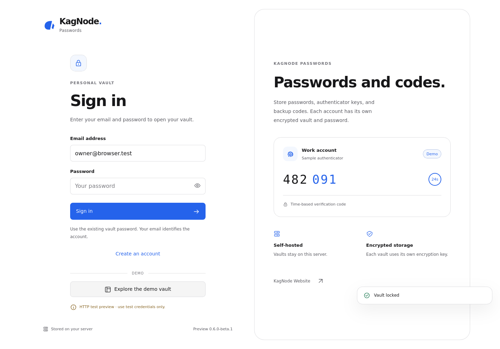

<p align="center"></p>

# KagNode Passwords

KagNode Passwords is the new name for KagNode Authenticator.

## Overview

Screenshots come from a disposable test preview with sample credentials.

| Sign in                                                                       | Overview                                                                           |
| ----------------------------------------------------------------------------- | ---------------------------------------------------------------------------------- |
|                                    |  |
|  |        |

| Step                                  | Detail                                                                                                                                                                                                     |
| ------------------------------------- | ---------------------------------------------------------------------------------------------------------------------------------------------------------------------------------------------------------- |
| One encrypted vault per email account | Each account keeps its own vault of saved logins, one-time-code (TOTP) entries, recovery codes and secure notes, with folder labels.                                                                       |
| Master password stays your fallback   | A KagNode sign-in does not unlock a vault by itself. Unlock needs your master password unless you opt in to [managed unlock](docs/MANAGED-UNLOCK.md), which keeps the master password as emergency access. |
| Mistakes are recoverable              | Deleted items go to Trash and return only when you restore them; nothing is removed for good until you ask.                                                                                                |
| Search and tools                      | Quick search (Ctrl K) finds entries; a password generator and a security check help keep entries strong.                                                                                                   |
| Optional Bitwarden apps               | An optional Vaultwarden service lets Bitwarden browser extensions and mobile apps connect.                                                                                                                 |
| Administrator controls                | Updates are controlled by the local administrator through the `kagnode` command (KagNode. Daemon).                                                                                                         |

## Release status

Product source: **5.0.3**. Stable source/data release: **5.0.3**.

KagNode 5 uses the same locally served Core login frame and action icons across applications.

## Features

- Secure notes and folder labels alongside saved logins, TOTP and recovery codes.
- Recoverable Trash with explicit restore and permanent removal.
- Optional Vaultwarden service for Bitwarden browser extensions and mobile applications.
- Local-administrator update controls backed by the KagNode Daemon manager.
- Separate encrypted vaults for multiple email accounts.
- TOTP entries, passwords and backup-code storage.

## Requirements

Python 3.12 for the validated development environment; HTTPS for remote use. See the existing reverse-proxy and vault setup instructions.

## Installation and downloads

Take releases only from [GitHub Releases](https://github.com/every-lemon/kagnode-passwords/releases) and verify `SHA256SUMS`.

| Payload                   | Formats                      | Support                                                        |
| ------------------------- | ---------------------------- | -------------------------------------------------------------- |
| Complete source / artwork | `.tar.xz`, `.tar.gz`, `.zip` | Named top-level directory; manual setup                        |
| Source/data               | `.deb`                       | Source only; does not provision a service                      |
| Source/data               | `.rpm`                       | Rocky Linux 10 source package; no native service qualification |

## Usage

```sh
python3 -m venv .venv
.venv/bin/pip install -r requirements.txt
.venv/bin/python -m authentactor
```

See [operations and existing setup instructions](docs/OPERATIONS.md) for the full workflow and its prerequisites.

## Configuration and storage

Shared presentation uses [KagNode Core](docs/CORE.md), with a pinned local fallback and reviewed server adapters. Compatible stable UI patches have a separate local-administrator policy.

## Security

Use HTTPS and least-privilege accounts for hosted services. Keep secrets and user data out of Git.

## Development and testing

```sh
python -m unittest discover -s tests -v
python3 scripts/repository_check.py
python3 scripts/format_source.py --check
python3 scripts/release.py --output dist/packages
```

## Documentation

|                                    |                                              |
| ---------------------------------- | -------------------------------------------- |
| Reviewed local setup               | [docs/INSTALLER.md](docs/INSTALLER.md)       |
| Passwords and Bitwarden clients    | [docs/PASSWORDS.md](docs/PASSWORDS.md)       |
| Ecosystem installation and updates | [docs/ECOSYSTEM.md](docs/ECOSYSTEM.md)       |
| Repository structure               | [docs/STRUCTURE.md](docs/STRUCTURE.md)       |
| Operations                         | [docs/OPERATIONS.md](docs/OPERATIONS.md)     |
| Packages and release process       | [docs/PACKAGING.md](docs/PACKAGING.md)       |
| Verification and limits            | [docs/VERIFICATION.md](docs/VERIFICATION.md) |
| KagNode Account linking            | [docs/ACCOUNT-SYNC.md](docs/ACCOUNT-SYNC.md) |
| Changelog                          | [CHANGELOG.md](CHANGELOG.md)                 |

## Licensing

See [LICENSE](LICENSE) and retained third-party notices. KagNode artwork retains its separate permission and brand policy; the application uses AGPL-3.0-only.
