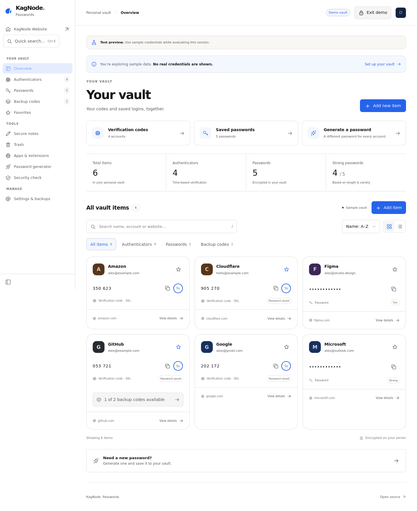
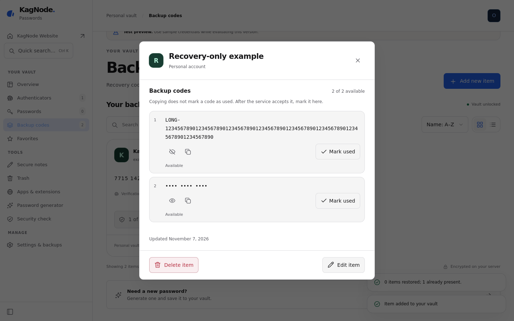
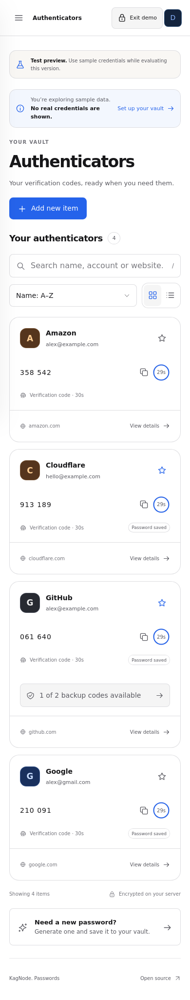

<p align="center"></p>

# KagNode Passwords

## Overview

KagNode Passwords is the new name for KagNode Authenticator. Existing emails, master passwords, encrypted vaults, backup files and service/package identities remain compatible.

Independent email-based accounts with encrypted authenticator vaults and backup codes.

### What it looks like

Screenshots come from a disposable test preview with sample credentials. No real vault or account is shown.

| Sign in                                                                       | Overview                                                                           |
| ----------------------------------------------------------------------------- | ---------------------------------------------------------------------------------- |
|                                    |  |
|  |        |

### How it works

1. **One encrypted vault per email account.** Each account keeps its own vault of saved logins, one-time-code (TOTP) entries, recovery codes and secure notes, with folder labels.
2. **Your master password stays required.** A KagNode identity can sign you in, but it never decrypts a vault; the master password and the existing vault encryption are still needed.
3. **Mistakes are recoverable.** Deleted items go to Trash and return only when you restore them; nothing is removed for good until you ask.
4. **Search and tools.** Quick search (Ctrl K) finds entries; a password generator and a security check help keep entries strong.
5. **Optional Bitwarden apps.** An optional Vaultwarden service lets Bitwarden browser extensions and mobile apps connect. Your existing vault is not synchronized silently: items move only through an explicit export and import.
6. **Administrator controls.** Updates are controlled by the local administrator through the KagNode CLI manager.

## Release status

Product source: **5.0.3**. Stable source/data release: **5.0.3**.

KagNode 5 uses the same locally served Core login frame and action icons across applications. Existing local sign-in, explicit KagNode connection, profile-sync policy, local roles and storage formats are preserved. Optional [KagNode-managed unlock](docs/MANAGED-UNLOCK.md) uses explicit consent and a trusted Rust key service. Existing vaults require one successful password unlock to enroll; later KagNode sign-ins can unlock them. Emergency master-password access remains available. Local-only mode stays the default.

Earlier packaging prereleases remain available. The 5.0 stable release is limited to the verified source/data and web-interface scope; native and hardware evidence remains separate. See [verification](docs/VERIFICATION.md) and [changelog](CHANGELOG.md).

Browser sign-in now returns from KagNode to this application in the same tab, using a one-use authorization code with S256 PKCE. Local email/username forms reveal the password step after identity entry; vault setup, MFA and key-only controls preserve their existing requirements. See [account sign-in](docs/ACCOUNT-SYNC.md).

## Features

The vault now uses a searchable list with folder/type filters and contextual details. Production demo data and duplicate overview shortcuts have been removed; existing encrypted vaults and recovery workflows are retained.

- Shared local sign-in and explicit Login with KagNode; local access and security requirements stay available. See [account sign-in](docs/ACCOUNT-SYNC.md).

- Secure notes and folder labels alongside saved logins, TOTP and recovery codes.
- Recoverable Trash with explicit restore and permanent removal.
- Optional Vaultwarden service for Bitwarden browser extensions and mobile applications. Existing vault data transfers only through an explicit export/import; the two stores do not silently synchronize.
- Local-administrator update controls backed by the KagNode Daemon manager.
- Separate encrypted vaults for multiple email accounts.
- TOTP entries, passwords and backup-code storage.
- Dedicated account and vault routes, export and recovery controls.

Optional KagNode Account linking syncs your display name and photo after explicit approval. Your local application administrator can disable it. Local sign-in and permissions stay independent.

## Requirements

Python 3.12 for the validated development environment; HTTPS for remote use. See the existing reverse-proxy and vault setup instructions.

## Installation and downloads

Download from [GitHub Releases](https://github.com/every-lemon/kagnode-passwords/releases). Verify `SHA256SUMS` before extracting or installing a package.

| Payload                   | Formats                      | Support                                                        |
| ------------------------- | ---------------------------- | -------------------------------------------------------------- |
| Complete source / artwork | `.tar.xz`, `.tar.gz`, `.zip` | Named top-level directory; manual setup                        |
| Source/data               | `.deb`                       | Source only; does not provision a service                      |
| Source/data               | `.rpm`                       | Rocky Linux 10 source package; no native service qualification |

The GitHub repository is now `every-lemon/kagnode-passwords`. Existing native and source-package identities remain compatible.

The existing `authentactor` Debian package builder remains in packaging/build-deb.sh.

Source packages install under `/usr/share/kagnode/`; they do not replace an existing application, migrate data, start services or configure networking. See [package details](docs/PACKAGING.md).

## Usage

```sh
python3 -m venv .venv
.venv/bin/pip install -r requirements.txt
.venv/bin/python -m authentactor
```

See [operations and existing setup instructions](docs/OPERATIONS.md) for the full workflow and its prerequisites.

## Configuration and storage

Shared presentation uses [KagNode Core](docs/CORE.md), with a pinned local fallback and reviewed server adapters. Compatible stable UI patches have a separate local-administrator policy.

The legacy authentactor package/service spelling is retained for compatibility. Never delete or reinitialize an existing vault to upgrade the UI.

## Security

Use HTTPS and least-privilege accounts for hosted services. Keep secrets and user data out of Git. Source/data packages support inspection and manual setup; native service and hardware claims remain limited to recorded verification. See [security guidance](docs/SECURITY.md).

## Development and testing

```sh
python -m unittest discover -s tests -v
python3 scripts/repository_check.py
python3 scripts/format_source.py --check
python3 scripts/release.py --output dist/packages
```

Install the formatting dependencies from `requirements-format.txt`. Package building additionally needs `dpkg-deb`, `rpmbuild`, XZ support and Rust 1.88+ to build the optional issuer key service. Read [the repository map](docs/STRUCTURE.md) before editing generated files.

## Documentation

- [Reviewed local setup](docs/INSTALLER.md)

- [Passwords and Bitwarden clients](docs/PASSWORDS.md)
- [Ecosystem installation and updates](docs/ECOSYSTEM.md)
- [Repository structure](docs/STRUCTURE.md)
- [Operations](docs/OPERATIONS.md)
- [Packages and release process](docs/PACKAGING.md)
- [Verification and limits](docs/VERIFICATION.md)
- [KagNode Account linking](docs/ACCOUNT-SYNC.md)
- [Changelog](CHANGELOG.md)

## Licensing

See [LICENSE](LICENSE) and retained third-party notices. KagNode artwork retains its separate permission and brand policy; the application uses AGPL-3.0-only.
